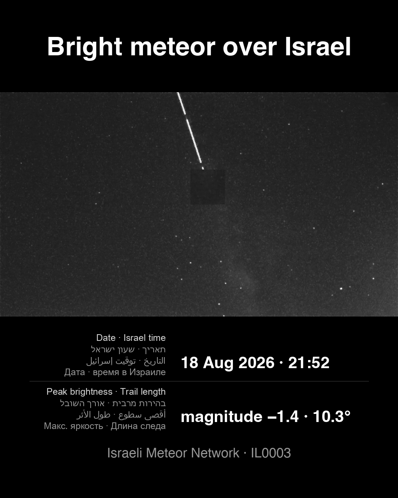

# Plan: Posting to the IAA's Social Media

**Status:** DRAFT — under review by IAA colleagues; nothing is built or posted yet.
**Date:** 2026-11-20
**Shared copy:** https://claude.ai/artifact/N2ZJTagzxQULhypM8iASE4 (comments from colleagues land there)
**Component:** would be a new `social.py` plus a portrait renderer, called from `bolides.py` and `trackstacks.py`

Each IMN station would post its own brightest meteors, and a recap of each meteor
shower when it ends, to the IAA's Facebook, Instagram and TikTok accounts. Posting
is fully automatic: there is no human approval step. Posts go through the IAA's
existing Postoria account (workspace `iaa_social`), which handles all three
networks with one API. YouTube is unchanged: IMN keeps uploading there itself, and
Postoria never posts to YouTube.

## What would appear

Every post is a short video, 1080×1350 (the 4:5 shape of Instagram's portrait
feed, also accepted by Reels and TikTok), made from the station's existing
landscape clip. The sample is a real meteor from IL0003 on 2026-08-18, used only
to show the format.

- **Top:** the title "Bright meteor over Israel", in English only.
- **Video:** the station's clip, slowed 2×. The meteor moves for about 1.3 s, then
  its final frame holds for 4 s so the whole trail can be seen. Total about 5.3 s.
- **Data block under the video:** two rows — date and Israel time together; peak
  brightness and trail length together. Each row's label is stacked in English,
  Hebrew, Arabic and Russian; its value appears once, in English.
- **Footer:** "Israeli Meteor Network" and the station code (e.g. IL0003).
- **No empty band.** In full-screen Reels and TikTok a 4:5 video is shown with
  black above and below, so the platforms' caption and buttons fall there rather
  than on our text.
- **Caption under the post:** the same facts as text, plus a link to the
  full-quality clip on the IMN YouTube channel.

Sample clip: [social-media/sample-clip.mp4](social-media/sample-clip.mp4).
Prototype that made both: [social-media/portrait_prototype.py](social-media/portrait_prototype.py).

The sample has two known flaws, both to fix before launch:

- The dark square under the trail is an artifact of IMN's fallback video renderer
  (`bolides._composite_frames`).
- At magnitude −1.4 this meteor would not qualify under the proposed rules (−4 or
  brighter); it is only a format sample.

The text is drawn by IMN as an image (Pillow) and laid over the video, so the
stations' ffmpeg 4.1.4 is enough (no `drawtext`/freetype). Whether the stations'
Pillow can lay out Hebrew and Arabic (needs libraqm), and whether they have a font
covering all four scripts, is still to be checked. The translations need checking
by native speakers.

## When and where each lands

A station runs IMN once a night, after dawn, when RMS finishes the night's
processing. Posts are published immediately, as soon as the station has made them,
so they normally appear in the morning after the night they show.

| What | Made when | Posted to | Lands as | Posted when |
| --- | --- | --- | --- | --- |
| Bright-meteor clip (4:5, sample above) | The morning after a night with a qualifying meteor; at most one per station per night | IAA Facebook page, IAA Instagram, IAA TikTok | Facebook: a Reel on the IAA page. Instagram: a Reel on the IAA profile and grid. TikTok: a video on the IAA account | Immediately, that morning |
| Shower recap (4:5, one frame per night of the shower, built up over its whole run) | The morning a station decides its shower is over: after 3 nights in a row with no meteors from it (`grace_nights`) | Same three accounts | Same as above | Immediately, that morning, so a few days after the shower ends |
| Bright-meteor clip (landscape, original) | Every night with meteors at magnitude −1 or brighter, up to 3 per station | IMN YouTube channel only, per-station monthly playlists | YouTube video | Immediately, as today (unchanged) |
| Shower stack video (landscape) | Every morning while a shower is active | IMN YouTube channel only | YouTube video, replaced each morning | Immediately, as today (unchanged) |

The IAA YouTube channel, which is also connected to Postoria, receives nothing from
this. Several stations may post the same meteor; each post names its own station.

## Decisions already taken

- **Each station decides on its own.** No central server choosing the best meteor
  of the night.
- **Fewer but better posts.** A station posts only when a meteor clears a fixed
  bar; most nights it posts nothing.
- **Duplicates are acceptable.** If three stations catch the same fireball, three
  posts may appear, each naming its station.
- **Fully automatic.** Automatic posting to the IAA accounts is acceptable; no one
  approves posts. The selection rules and the video quality are the only
  safeguards.
- **Posts publish immediately**, as soon as the station has made them; nothing is
  scheduled.
- **Title and values in English; data labels stacked in English, Hebrew, Arabic
  and Russian.**
- **Stations are shown by their code** (e.g. IL0003), not a place name.
- **Shower recaps are posted once, when the shower ends**, not nightly.
- **Networks: Facebook, Instagram and TikTok.** Never YouTube through Postoria;
  IMN already publishes there.
- **The real test post** is done by the project owner once colleagues approve.

## Selection rules (proposed)

All numbers become settings in `config.toml` (`[social]`), so they can be tuned
without code changes. The feature ships switched off.

| Rule | Proposed value | Why |
| --- | --- | --- |
| Meteor brightness | Peak magnitude −4 or brighter, or a large share of saturated frames | Saturation makes a very bright meteor read fainter than it was, so it is the more reliable sign |
| Trail length | A minimum, value to be set from real nights | Excludes short flashes, often not meteors |
| Video available | The station recorded FR frames of the meteor | No video, nothing to post |
| Posts per station | At most 1 per night, the best one | Fewer but better |
| Shower recap | At least 3 nights and 20 meteors in the stack | A recap of 2 nights and 6 meteors is a weak post |

How often a station would post under these values is not known yet. Before launch,
run the rules over past nights from several stations and count.

## What Postoria supports

Checked against the [public API guide](https://postoria.io/help-center/postoria-public-api)
and the [API specification](https://api.postoria.io/v1/openapi.json), and with
read-only calls to the IAA workspace. Nothing has been uploaded or posted.

| Question | Answer | Checked how |
| --- | --- | --- |
| Video uploads | Yes: MP4 and MOV, up to 5 GiB per file. Our clips are ~0.2 MB | API specification |
| Video posts to Facebook, Instagram, TikTok | Yes, as `video` or `reel` posts, up to 1 GiB (TikTok 4 GiB) | API specification |
| Thumbnail from a chosen video frame | Yes (`thumbnail_timestamp_ms`); we would use the final frame | API specification |
| Drafts | No — the API cannot create drafts | API guide |
| Subtitle/caption tracks | No | API specification |
| Accounts in workspace `iaa_social` (id 13679, tz Asia/Jerusalem) | Facebook (IAA page), Instagram (IAA), TikTok (IAA), YouTube (IAA) | Live call |
| Minimum duration and aspect ratio per network | Not documented; each network checks at publish time | Needs the real test post |

API shape, for the implementation: upload is `POST /media/uploads` → `PUT` the
bytes to `upload.url` → `POST /media/{id}/complete` → poll `GET /media/{id}` until
`status` is `ready`. A post is `POST /posts` with
`{"publish_mode": "publish_now", "social_account_ids": [...], "content_type": "reel",
"media": [{"media_id": ..., "thumbnail_media_id": ...}], "caption": ...}`.
The `post_batch.py` script this started from uses fields (`text`, `media_ids`) that
are not in this schema; don't copy it.

## Work needed in IMN

1. **Portrait renderer.** Turn the landscape clip into the 4:5 version with the
   text block and a 4 s hold. The prototype made the sample above.
2. **Fix the renderer artifact** (the dark square), or skip any clip that shows it.
3. **Postoria client** (`social.py`, modelled on `youtube.py`). Upload, wait until
   processed, then publish immediately to Facebook, Instagram and TikTok. Accounts
   are chosen by network, so a YouTube account in the workspace is never used.
   Python 3.7, `urllib` unless `requests` is confirmed in `~/vRMS`.
4. **Hook into the nightly run.** After the YouTube upload, pick at most one
   qualifying meteor and post it. When a station decides a shower has ended, build
   the recap and post it. Today `publish_shower_stacks` deletes the state entry at
   that moment, so the entry must instead be kept as "ended, not yet posted" until
   a post succeeds (or a few attempts fail).
5. **Remember what was posted** (manifest / `trackstacks.json`), so a re-run never
   posts the same meteor twice.
6. **Credentials and settings.** The Postoria key lives in `~/.config/IMN`
   (e.g. `postoria.json` with key + workspace id), never in the repo, and
   `imn --init/--update` copy it to stations alongside `youtube.json`. All rules
   above become `imnconfig.DEFAULTS` entries, off by default.
7. **Safety on the station.** Every network call has a timeout, the polling loop is
   bounded, and every step is wrapped so a failure cannot hold RMS's reboot lock —
   as the YouTube upload already does.
8. **Trial run.** Run the rules over past nights to see how often stations would
   post, then one real test post, then enable on one station before the rest.

## Risks and open questions

**Risks**

- **A false detection goes public.** With no approval step, a plane, lightning,
  headlights or a satellite flare mistaken for a bright meteor would be posted.
  Strict rules reduce this. Because posts publish immediately, a bad one can only
  be removed from the networks after it has appeared.
- **Too many or too few posts.** Unknown until the rules are run over past nights.
- **The Postoria key is a full-access key** to the IAA social accounts and will sit
  on every station. The key that was shared in `post_batch.py` should be replaced
  before launch.
- **Network rules can change.** Instagram or TikTok may reject or crop a 5-second
  4:5 video; only a real post will tell.

**Open questions for colleagues**

- [ ] Do you approve this plan, so the test post can go ahead?
- [ ] Are the Hebrew, Arabic and Russian labels on the sample right? Who can check
      the Arabic and the Russian?
- [ ] What should the caption under each post say, and which hashtags?
